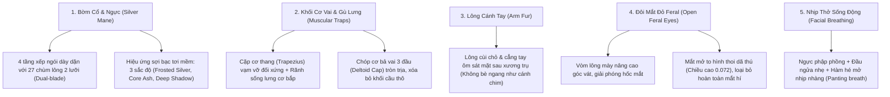

# BẢN ĐẶC TẢ MASTER PROMPT: TINH CHỈNH CHI TIẾT LÔNG THÚ (FUR MANTLE) & ÁNH SÁNG THREE.JS
## (Stylized Low-Poly Faceted Werewolf — Tối ưu Bờm ngực, Vai, Tay, Chân & Loại bỏ Lửa trại)

---

# MỤC LỤC
1. [I. BỐI CẢNH & PHẠM VI TINH CHỈNH (NON-DESTRUCTIVE REFACTOR)](#i-bối-cảnh--phạm-vi-tinh-chỉnh-non-destructive-refactor)
2. [II. KỸ THUẬT DỰNG HÌNH KHỐI LÔNG ĐA DIỆN 3D (FACETED FUR SHARD FORMULA)](#ii-kỹ-thuật-dựng-hình-khối-lông-đa-diện-3d-faceted-fur-shard-formula)
3. [III. ĐẶC TẢ HÌNH HỌC 4 PHÂN VÙNG LÔNG TRỌNG TÂM](#iii-đặc-tả-hình-học-4-phân-vùng-lông-trọng-tâm)
4. [IV. HỆ THỐNG ÁNH SÁNG & BẢNG MÀU STUDIO DARK FANTASY (BỎ ĐỐM LỬA)](#iv-hệ-thống-ánh-sáng--bảng-màu-studio-dark-fantasy-bỏ-đốm-lửa)
5. [V. TOÀN VĂN PROMPT MẪU TÁI SỬ DỤNG CHO DÒNG QUÁI THÚ LÔNG XÙ](#v-toàn-văn-prompt-mẫu-tái-sử-dụng-cho-dòng-quái-thú-lông-xù)

---

# I. BỐI CẢNH & PHẠM VI TINH CHỈNH (NON-DESTRUCTIVE REFACTOR)

> [!IMPORTANT]
> **Nguyên tắc cốt lõi**:
> 1. **Giữ nguyên 100% tỷ lệ hình thể (Proportions)**: Dáng đứng lưng gù dã thú (*Hunched Brute Stance*), thân chữ V, đầu nhô chúc tới trước, chân khuỵu *digitigrade* 120° đã được duyệt.
> 2. **Chỉ can thiệp cục bộ vào các lớp lông bề mặt (Surface Fur Detailing)**: Bờm ngực (*Chest Mane*), giáp vai (*Deltoid Fur Mantle*), cẳng tay & cùi chỏ (*Forearm & Elbow Tufts*), đùi & đầu gối (*Thigh Plates & Knee Cap*).
> 3. **Loại bỏ triệt để đốm lửa trại (Campfire Removal)**: Thay thế ánh sáng vàng cam hắt dưới sàn bằng hệ thống ánh sáng viền tím ma thuật (*Purple Rim*) kết hợp hắt trăng xanh (*Moonlit Ground Bounce*), giúp các diện phẳng vát (*facets*) sắc nét, rõ ràng, không bị chìm trong bóng tối.

---

# II. KỸ THUẬT DỰNG HÌNH KHỐI LÔNG ĐA DIỆN 3D (FACETED FUR SHARD FORMULA)

### 2.1. Sai lầm kinh điển cần tránh (Anti-Patterns)
* ❌ **Cắm nón `ConeGeometry` 4 cạnh tròn/hẹp**: Khiến lông giống như những chiếc gai nhọn hoặc gai nhím cắm tùy tiện vào thân, phá vỡ cảm giác "bờm thú uy mãnh".
* ❌ **Dùng mặt phẳng 2D `PlaneGeometry`**: Khi nhìn góc nghiêng 3/4 hoặc từ trên xuống, lông bị mỏng dính như giấy, lộ rõ lỗi đồ họa.
* ❌ **Lông quá hẹp và dài dạng sợi**: Khiến bờm ngực trông như râu dê thon dài, che khuất tỷ lệ eo và bụng.

### 2.2. Giải pháp chuẩn: Cấu trúc Nêm Đa Diện 3D (3D Faceted Diamond Shard)
Mỗi cụm lông thú Low-Poly Stylized phải được xây dựng từ một khối đa diện kín (Solid Polyhedron) có:
1. **Sống lưng nhô cao (Prominent Center Ridge)**: Trục $Z$ tại trung tâm nhô cao về phía trước, tạo thành 2 sườn vát chéo $35^\circ - 45^\circ$.
2. **Hai cánh xòe rộng (Flared Lateral Wings)**: Chiều rộng $W$ tương đương $70\% - 90\%$ chiều dài $L$ để tạo thành các phiến đá/pha lê lông thú dày dặn.
3. **Mặt đáy vát thuôn nhọn (Chiseled Bevel Tip)**: Đáy vuốt nhọn thành mũi mác dứt khoát.
4. **Mặt sau có độ dày (Back Hull)**: Đảm bảo nhìn từ mọi góc xoay $360^\circ$ đều là khối đặc 3D.

```javascript
/**
 * Thuật toán dựng phiến lông đa diện 3D Low-Poly bắt sáng độc lập
 */
function createFacetedFurShard(width, length, depth = 0.045, flare = 1.0) {
  const hw = width * 0.5;
  const midY = -length * 0.38;
  const tipY = -length;

  // 8 đỉnh định hình khối nêm pha lê lông đa diện
  const verts = [
    -hw * 0.7,   0.02,  -depth * 0.15, // 0: Đỉnh trái chân lông
     hw * 0.7,   0.02,  -depth * 0.15, // 1: Đỉnh phải chân lông
     0.00,       0.03,   depth * 0.45, // 2: Sống lưng trên
    -hw * flare, midY,   depth * 0.15, // 3: Cánh xòe mép trái
     hw * flare, midY,   depth * 0.15, // 4: Cánh xòe mép phải
     0.00,       midY,   depth,        // 5: Đỉnh nhọn sống lưng giữa (Bắt sáng mạnh nhất!)
     0.00,       tipY,   depth * 0.20, // 6: Mũi mác đáy nhọn
     0.00,       midY * 0.8, -depth * 0.25 // 7: Sống lưng đáy sau (Tạo khối đặc 3D)
  ];

  const indices = [
    0, 2, 3,   2, 5, 3,   // Diện vát mặt trước trên - trái
    2, 1, 4,   2, 4, 5,   // Diện vát mặt trước trên - phải
    3, 5, 6,   5, 4, 6,   // Diện vát mũi mác dưới - thuôn nhọn
    0, 1, 2,              // Nắp chân lông gắn vào da
    0, 3, 7,   1, 7, 4,   // Khối vát lưng sau
    3, 6, 7,   4, 7, 6, 
    0, 7, 1
  ];

  const geo = new THREE.BufferGeometry();
  geo.setAttribute('position', new THREE.BufferAttribute(new Float32Array(verts), 3));
  geo.setIndex(indices);
  return makeFlat(geo); // Bắt buộc non-indexed để từng mặt phẳng phẳng lì (Flat Shading)
}
```

---

# III. ĐẶC TẢ HÌNH HỌC 5 PHÂN VÙNG TINH CHỈNH TRỌNG TÂM



---

## 3.1. Phân vùng 1: Bờm Bạc Nằm Phía Trước Bờm Má & Khoét Cổ Tự Nhiên (Layered Front Mane)
* **Kỹ thuật phân tầng chiều sâu (Z-Layering: Bờm lớn nằm trước bờm nhỏ)**:
  * Cụm bờm má nhỏ (`createCheekMane`) được đẩy lùi về phía sau dọc xương hàm và dưới tai tại $Z = -0.040 \text{ đến } -0.080$.
  * Cụm bờm ngực lớn (`chestManeGroup`) đưa nhô về phía trước tại $Z = 0.235, Y = -0.035$, phủ lên trên mặt trước của bờm má, tạo độ dày dặn và chiều sâu lớp lông dã thú rõ rệt.
* **Khoét cổ cong thoát miệng (Scooped Collar — Chấm dứt lỗi "sói gặm bờm")**:
  * Tại trục giữa cổ ($X = 0, \pm 0.05$), tầng bờm trên cùng được hạ thấp ($Y = 0.02 - 0.03, Z = 0.005$) tạo đường cong cổ áo lõm tự nhiên dưới yết hầu.
  * Khoảng cách thẳng đứng giữa đáy hàm dưới và đỉnh bờm ngực đạt $> 0.08$ đơn vị, đảm bảo khi sói há to miệng, gầm thét hay thở dốc thì hàm dưới, răng nanh và vòm miệng đỏ thẫm luôn tách biệt hoàn toàn ở phía trên, không bị đâm hay chìm vào bờm.
* **Cấu trúc 4 tầng với 27 chùm lông đa diện**:
  * Tầng 1: Vòng cổ họng (7 chùm xòe quạt, lớp bóng tối sâu `#5a5464`).
  * Tầng 2: Bản ngực vạm vỡ (8 chùm xếp ngói đan xen xám tro `#7e7888`).
  * Tầng 3: Giữa xương ức (7 chùm điểm xuyết lông bạc sáng `#9e99a8`).
  * Tầng 4: Mũi giáo hạ ức (5 chùm vuốt nhọn về phía thắt lưng).

---

## 3.2. Phân vùng 2: Khối Cơ Vai & Gù Lưng Giải Phẫu (Anatomical Muscular Trapezius)
* **Khắc phục triệt để lỗi khối cầu thô (Dodecahedron soccer ball)**:
  * Thay thế khối 12 mặt bằng **cặp cơ thang vạm vỡ (Dual Trapezius Muscle Slabs)**: Hai khối lăng trụ cơ bắp 6 cạnh đặt tại $X = \pm 0.11$, nghiêng vát $0.26 \text{ rad}$ ôm dốc từ cổ xuống bả vai.
  * Giữa 2 khối cơ thang là **rãnh cơ sống lưng (Spine Furrow)**, tạo chiều sâu giải phẫu học dã thú chân thực.
  * **Cơ bả vai (Deltoid Cap)**: Khối cơ 3 đầu ôm tròn đầu xương cánh tay, các phiến lông vai ép sát cơ bắp góc $20^\circ$.

---

## 3.3. Phân vùng 3: Lông Tay Ôm Sát Cơ Thể (Contoured Arm Fur)
* Đưa toàn bộ các cựa lông cùi chỏ và cẳng tay lùi về **mặt sau xương trụ (Posterior Ulna Ridge)** ($Z = -0.055 \text{ đến } -0.065$, $X = \pm 0.025$).
* Triệt tiêu góc xoay bẹt sang ngang; các phiến lông vuốt dọc theo chiều dài cánh tay, giữ cho silhouette cánh tay thon gọn, cơ bắp cuồn cuộn mà không bị xòe rộng thành cánh.

---

## 3.5. Phân vùng 5: Đôi Mắt Mở To Dữ Tợn (Open Feral Glowing Eyes)
* **Nâng vòm lông mày**: Đẩy `browMesh` lên $Y = 0.080, Z = 0.060$, giảm độ dốc (`rotation.x = -0.22`), xóa bỏ hoàn toàn mái che gây bóng đen sụp mí.
* **Khối mắt 4 diện vát**: Mở rộng chiều cao mắt lên $0.072$ đơn vị (từ $Y = -0.022$ đến $+0.052$), đỉnh mắt vếch chéo dã thú, tâm mắt nhô về phía trước ($Z = 0.138$) giúp đôi mắt đỏ rực nổi bật và sắc lạnh từ mọi góc nhìn, loại bỏ hoàn toàn cảm giác "mắt hí".

---

## 3.6. Phân vùng 6: Chân Khuỵu Cơ Bắp Vát Phẳng (Clean Muscular Digitigrade Legs)
* **Loại bỏ hoàn toàn lông ở 2 bên chân sói**: Xóa bỏ 3 phiến lông bậc thang ở mép ngoài đùi và các cựa gót chân Asin, giúp đường nét giải phẫu cơ bắp vát phẳng (*chiseled muscular facets*) liền mạch, vững chãi đúng tinh thần concept gốc.
* **3 vết cào móng vuốt sẫm màu (`darkFurMat`)**: Giữ lại các vệt cào chìm phẳng trên mặt trước đùi làm điểm nhấn dã thú.
* **Tư thế khuỵu 120° chân chó (Digitigrade)**: Khớp gối mở rộng sang hai bên $X = \pm 0.25$, gập lùi về sau và cắm vững bàn chân 3 móng vuốt ngà xuống mặt sàn $Y = 0.00$.

---

## 3.7. Phân vùng 7: Chiếc Đuôi Bó Chổi Thuôn Gọn (Streamlined Broomstick Tail)
* **Khắc phục lỗi lông chỉa lung tung (Anti-messy Radial Spikes)**:
  * Triệt tiêu hoàn toàn góc xoay 360 độ tán xạ ngẫu nhiên quanh trục; toàn bộ các chùm lông được **định hướng vuốt dọc theo trục xương sống đuôi (-Z)**.
  * Thân đuôi chia 3 đoạn liền mạch: Gốc đuôi (`stemMesh`), thân phình nhẹ (`midCore`), và chóp đuôi vuốt nhọn (`tipCone`).
* **Cấu trúc xếp lông ôm sát (Cohesive Feathering Layers)**:
  * **Sống lưng đuôi (Top Ridge)**: 4 phiến lông mượt mà chạy dọc mặt trên sống đuôi.
  * **Hai bên hông đuôi (Flank Tufts)**: 4 cặp chùm lông ôm sát 2 bên mạn sườn đuôi ($X = \pm 0.055$), vuốt xuôi về sau góc nghiêng hẹp $12^\circ - 15^\circ$.
  * **Bụng dưới đuôi (Underside)**: 3 phiến lông đỡ đáy đuôi.
  * **Chóp đuôi bó chổi (Broom Tip Apex)**: 3 mũi mác chụm đầu lại ở đỉnh chóp điểm xuyết màu lông bạc xám tro (`chestManeMat`), tạo dáng đuôi bó chổi bay thanh thoát, uy lực mà vô cùng gọn gàng.

---

## 3.8. Phân vùng 8: Nhịp Thở Sống Động Đồng Bộ Thân, Mặt & Miệng Sói (Organic Facial & Body Respiration)
Khi bật chế độ thở, chu kỳ thở `breathCycle = (Math.sin(elapsedTime * 2.2) + 1.0) * 0.5` (từ 0.0 đến 1.0) diễn ra chậm rãi, sâu và uy lực (~2.8 giây/nhịp):
1. **Lồng ngực & Bờm bạc**:
   * Thân hình được tinh chỉnh mỏng và thon gọn (tỷ lệ $Z$-scale của ngực giảm về $0.62$, hông về $0.65$), giúp lồng ngực phập phồng nhẹ nhàng ($Z +2.5\%$) mà **tuyệt đối không bao giờ chồi xuyên qua hay che khuất bờm bạc**.
   * Cụm bờm bạc `chestManeGroup` phồng nở nhịp nhàng ($Z +4\%$) đồng điệu cùng lồng ngực.
2. **Khuôn mặt & Mõm sói (Facial & Snout Respiration)**:
   * Đầu sói `headGroup` nâng cao nhẹ ($Y = 0.70 + breathCycle \times 0.016$) và ngửa đầu đón khí (`rotation.x = -0.06 - breathCycle * 0.045`).
   * Mõm `muzzleGroup` phập phồng nở nhẹ ($X +4\%, Z +5\%$) và hếch lên mô phỏng lỗ mũi dã thú hít thở.
   * Vòm trán `browMesh` co giãn nhẹ tạo biểu cảm gầm gừ sống động.
3. **Miệng & Hàm dưới hé mở thở dốc (Mouth Panting)**:
   * Khớp xoay hàm `lowerJawPivot.rotation.x = userBaseMouth + breathCycle * 0.12` (biên độ $0.12\text{ rad} \approx 7^\circ$), hé mở rõ rệt để lộ nanh vuốt và khoang miệng đỏ thẫm.
4. **Đuôi bó chổi đung đưa (Tail Swish)**:
   * Đuôi ngoáy nhẹ sang 2 bên kết hợp dập dềnh theo nhịp thở.

---

## 3.9. Phân vùng 9: Đuôi Bó Chổi Bay Gọn Gàng (Streamlined Broomstick Fur Tail)
* **Khắc phục lỗi xòe bung 360°**: Phiên bản trước lông đuôi chìa tròn tứ phía gây rối mắt và thô ráp.
* **Cấu trúc khí động học thuôn dài gọn gàng**:
  * **Sống lưng đuôi trên (Dorsal Spine)**: 4 chùm lông xếp ngói xuôi theo độ cong của đuôi (`rotation.x = -0.55`).
  * **Hai bên hông đuôi (Flank Tuft Pairs)**: 4 cặp chùm lông ép sát vào thân ($X = \pm 0.055$), không xòe ngang quá $15^\circ$.
  * **Mặt bụng dưới đuôi (Ventral Tufts)**: 3 chùm lông xuôi gọn gàng che kín mặt dưới.
  * **Đầu chót đuôi (Apex Spear Tufts)**: 3 ngọn giáo lông nhọn hoắt vuốt nhọn ở chóp đuôi ($Y = -0.16, Z = -0.34$).

---

# IV. HỆ THỐNG ÁNH SÁNG & BẢNG MÀU STUDIO DARK FANTASY (BỎ ĐỐM LỬA)

```
                            [Top-Back Purple Rim Light]
                            (0xc084fc, Intensity 2.6)
                            Pos: (-1.5, 2.5, -2.0)
                                      |
                                      v
                                (GÙ LƯNG & TAI)
                                      |
   [Front Key Light] --------> [MA SÓI 3D] <-------- [Right Rim Light]
 (0xe0e8f8, Intensity 1.28)   (Không chìm bóng)      (0x6078a6, Intensity 0.60)
  Pos: (0.8, 3.2, 2.5)                |              Pos: (2.5, 2.0, -1.5)
  *Cast Shadow: true*                 v
                         [BÓNG ĐỔ SÀN PEDESTAL]
                         (Cylinder 1.6 x 0.06 x 24)
                                      ^
                                      |
                         [Moonlit Ground Bounce Light]
                          (0x525a75, Intensity 0.40)
```

### 4.1. Bảng màu chuẩn xác (Hex Material Palette)
| Tên thành phần | Mã Hex | Roughness | Chức năng thẩm mỹ |
| :--- | :--- | :--- | :--- |
| **`darkFur`** | `#282633` | 0.90 | Lưng gù, gai sống lưng, vảy vai, gót chân |
| **`primaryFur`** | `#3e3b4a` | 0.90 | Khối thân chính, bắp tay, bắp chân (Đủ sáng để lộ facet) |
| **`snoutFur`** | `#4f4b5d` | 0.90 | Sống mũi, vòm trán phẳng |
| **`chestMane`** | `#7c7688` | 0.88 | Bờm ngực, lông má, đầu gối (Tạo điểm nhấn tương phản cao) |
| **`eyes`** | `#ff261b` | MeshBasic | Đôi mắt đỏ rực phát sáng |
| **`teeth / claws`** | `#e8e5e2` | 0.45 | Nanh vuốt sắc nhọn xương ngà |
| **`floorPedestal`** | `#16141e` | 0.92 | Bệ đá tròn hứng bóng đổ tiếp đất (Ground Shadow) |

### 4.2. Hệ thống Bóng Đổ Sàn Tiếp Đất Chuẩn Seer (Ground Pedestal & Shadows)
1. **Thiết lập Renderer Shadow Map**:
   ```javascript
   renderer.shadowMap.enabled = true;
   renderer.shadowMap.type = THREE.PCFSoftShadowMap;
   ```
2. **Nguồn sáng đổ bóng chính (Front Key Light)**:
   * Vị trí trên cao chếch trước: `position.set(0.8, 3.2, 2.5)`
   * Kích thước Shadow Map sắc nét: `shadow.mapSize.set(2048, 2048)`
   * Giới hạn Camera trực giao: `near: 0.5, far: 10, left: -1.4, right: 1.4, top: 1.6, bottom: -0.6`
   * Shadow bias triệt tiêu sọc bóng (shadow acne): `bias = -0.0005`
3. **Bệ đá Low-Poly hứng bóng (`floorMesh`)**:
   * Khối hình trụ vát nhẹ: `CylinderGeometry(1.6, 1.7, 0.06, 24)` đặt tại `Y = -0.03`
   * Chất liệu mờ tối màu đá hốc cây: `color: 0x16141e, roughness: 0.92, metalness: 0.05, flatShading: true`
   * `floorMesh.receiveShadow = true` hứng trọn bóng đổ tiếp đất của 2 bàn chân thú và 2 bộ móng vuốt.
4. **Nút gạt Bật/Tắt bóng đổ UI (Sidebar Switch)**:
   * Cho phép người dùng bật/tắt tức thì hiệu năng bóng đổ và hiển thị bệ đá thông qua toggle `#toggle-shadows`.

> [!CAUTION]
> **Khống chế nguồn sáng mắt sói (Eye Glow PointLight)**:
> Tuyệt đối không để `PointLight` mắt ở cường độ cao ($> 0.2$) hoặc đặt quá sát trán. Chỉ sử dụng `PointLight(0xff1e1e, intensity = 0.08, distance = 0.10)` đặt tại $(0, 0.025, 0.16)$, để trán sói giữ nguyên màu đá phiến tự nhiên, không bị cháy sáng đỏ ửng.

---

# V. TOÀN VĂN PROMPT MẪU TÁI SỬ DỤNG CHO DÒNG QUÁI THÚ LÔNG XÙ

*Người dùng có thể sao chép nguyên văn prompt dưới đây để áp dụng vào bất kỳ nhân vật quái thú Low-Poly (Ma Sói, Gấu Thiết Giáp, Dã Nhân Yeti, Hổ Răng Kiếm) nào:*

```markdown
# PROMPT: PROCEDURAL 3D LOW-POLY FACETED FUR & STUDIO LIGHTING REFINEMENT

Bạn là Senior Three.js Developer & 3D Character Technical Artist.
Hãy thực hiện tinh chỉnh chuyên sâu bề mặt lông thú (Procedural Low-Poly Fur Shards) và hệ thống ánh sáng chuẩn Dark Fantasy WebGL cho nhân vật thú nhân (Ma Sói).

YÊU CẦU BẮT BUỘC:

1. NGUYÊN TẮC HÌNH HỌC LÔNG (3D FACETED SHARD GEOMETRY):
   - Tuyệt đối KHÔNG dùng ConeGeometry tròn trơn hoặc PlaneGeometry 2D mỏng dính.
   - Xây dựng hàm tạo phiến lông 3D khép kín `createFacetedFurShard(width, length, depth, flare)`:
     * Cấu tạo từ 8 đỉnh định hình khối nêm pha lê 3D (Solid Diamond/Crystal Wedge).
     * Sống lưng giữa nhô cao (Z = depth) tạo 2 diện vát bắt sáng đối xứng.
     * Hai cánh xòe rộng (width = 0.7 - 0.9 length) và vát nhọn về phía mũi mác.
     * Toàn bộ geometry dùng non-indexed + computeVertexNormals() phẳng lì (makeFlat).

2. TINH CHỈNH 4 VÙNG LÔNG TRỌNG TÂM:
   - BỜM CỔ & NGỰC (Chest Mane):
     * Cấu trúc 3 tầng xếp ngói hình cánh quạt bao trọn từ yết hầu đến xương ức (chiều rộng X = -0.22 đến +0.22, Y = 0.48 đến 0.72).
     * Màu xám tro sáng (#7c7688), bật polygonOffset (-1.5) để loại bỏ 100% z-fighting với thân.
   - BẢ VAI (Deltoid Mantle):
     * 3 phiến lông đa diện cỡ lớn vuốt lùi về sau lưng góc 35° che kín hoàn toàn khớp xoay vai.
   - CÁNH TAY & CÙI CHỎ (Arm & Elbow):
     * 2 cựa lông cùi chỏ vểnh ngược 45°, 3 gai lông đa diện dọc xương trụ và vòng đệm lông xòe tại cổ tay trước khi nối vào 4 móng vuốt ngà cong.
   - ĐÔI CHÂN KHUỴU (Bowed Digitigrade Legs):
     * 3 phiến lông bậc thang dọc đùi ngoài, chóp lông đầu gối dạng mũi mác chúc xuống (#7c7688), và 2 cựa lông gót chân Asin.

3. HỆ THỐNG ÁNH SÁNG & BỎ HOÀN TOÀN LỬA TRẠI (NO CAMPFIRE):
   - Loại bỏ toàn bộ hình học lửa, khói và PointLight vàng cam dưới sàn.
   - Thiết lập hệ thống chiếu sáng Studio Dark Fantasy gồm 5 đèn:
     * AmbientLight (0x3e3c4e, 1.25)
     * DirectionalLight viền tím trên đỉnh sau (0xc084fc, 2.6) tại (-1.5, 2.5, -2.0)
     * DirectionalLight rọi mặt chính diện (0xe0e8f8, 1.28) tại (0.6, 2.0, 2.5)
     * DirectionalLight viền phải (0x6078a6, 0.60)
     * DirectionalLight hắt trăng xanh dưới sàn (0x525a75, 0.40) tại (0, -1.0, 0.8)
   - Đôi mắt phát sáng bằng MeshBasicMaterial (#ff261b), đèn phụ eyeLight chỉ để intensity = 0.08, tránh làm cháy đỏ vùng trán và sống mũi sói.

4. HIỆU ỨNG NHỊP THỞ HỮU CƠ ĐỒNG BỘ (ORGANIC FACIAL & BODY BREATHING):
   - Chu kỳ thở sâu dã thú: `breathCycle = (Math.sin(time * 2.2) + 1.0) * 0.5` (~2.8s/nhịp).
   - Lồng ngực & Bờm bạc: Ngực nở trục Z (+9%) và X (+5%), bờm bạc phồng nở (+7%) và nghiêng nhẹ theo nhịp hít.
   - Khuôn mặt & Mõm sói: Đầu nhấp nhô (Y +0.016) và ngửa nhẹ (X -0.045 rad), mõm sói phập phồng (Z +5%) và hếch lên theo nhịp hít.
   - Miệng & Hàm dưới: Khớp xoay hàm hé mở rõ rệt (biên độ 0.12 rad ~ 7°) đồng bộ cùng nhịp hít, để lộ nanh vuốt và vòm miệng đỏ thẫm.
```

