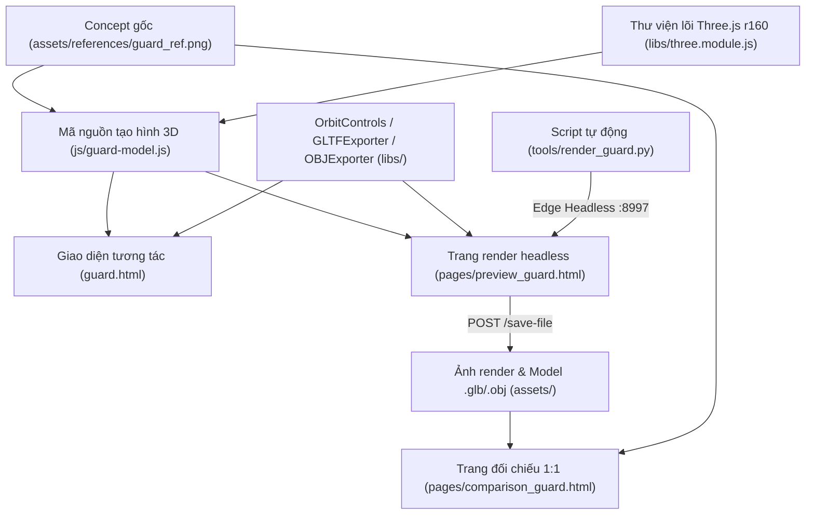

# Tài Liệu Kỹ Thuật & Thiết Kế Ngoại Hình Nhân Vật Guard (Hiệp Sĩ Bảo Vệ)

Tài liệu mô tả chi tiết toàn bộ quy trình hình thành giao diện và mô hình 3D nhân vật **Guard (Knight)** — từ nền tảng công nghệ, kiến trúc mã nguồn, thiết lập ánh sáng/renderer, giao diện tương tác UI/UX cho đến đặc tả hình học, vật liệu, bảng màu, tư thế và hiệu ứng chuyển động.

---

## Mục lục
1. [Kiến trúc tổng thể & Các tệp liên quan](#1-kiến-trúc-tổng-thể--các-tệp-liên-quan)
2. [Phần I: Công nghệ & Kỹ thuật đồ họa](#2-phần-i-công-nghệ--kỹ-thuật-đồ-họa)
3. [Phần II: Ngoại hình chi tiết nhân vật Guard](#3-phần-ii-ngoại-hình-chi-tiết-nhân-vật-guard)
4. [Phần III: Hệ thống Tư thế, Hoạt ảnh & API điều khiển](#4-phần-iii-hệ-thống-tư-thế-hoạt-ảnh--api-điều-khiển)
5. [Ghi chú đối chiếu trạng thái tệp render](#5-ghi-chú-đối-chiếu-trạng-thái-tệp-render)

---

## 1. Kiến trúc tổng thể & Các tệp liên quan



| Tệp nguồn | Vai trò chính |
| :--- | :--- |
| [guard-model.js](../js/guard-model.js) | Dựng toàn bộ hình học 3D, vật liệu PBR, bảng màu mặc định, hiệu ứng hạt, tư thế và API điều khiển |
| [guard.html](../guard.html) | Giao diện web tương tác chính (scene 3D, ánh sáng sân khấu, sidebar tùy biến, xuất `.glb`/`.obj`) |
| [preview_guard.html](../pages/preview_guard.html) | Trang dựng tối giản phục vụ chụp ảnh đa góc nhìn và xuất model tự động qua query URL |
| [comparison_guard.html](../pages/comparison_guard.html) | Trang đặt song song 1:1 ảnh concept gốc và ảnh render mặt trước |
| [render_guard.py](../tools/render_guard.py) | HTTP server nội bộ (cổng `8997`) + điều khiển Microsoft Edge chế độ `--headless=new` để chụp ảnh và lưu model |
| [guard_ref.png](../assets/references/guard_ref.png) | Ảnh concept mẫu 2D dùng làm chuẩn đối chiếu hình khối, ánh sáng và bảng màu |

---

## 2. Phần I: Công nghệ & Kỹ thuật đồ họa

### 2.1. Nền tảng WebGL, Three.js r160 & ES Modules
* **Không sử dụng file 3D dựng sẵn trên web**: Toàn bộ mô hình được sinh ra trực tiếp bằng mã JavaScript (Procedural 3D) thông qua hàm [`createGuardCharacter`](../js/guard-model.js#L31-L909).
* **Three.js cục bộ (`REVISION = '160'`)**: Nạp từ [three.module.js](../libs/three.module.js) bằng chuẩn **ES Modules** và `<script type="importmap">` ngay trong HTML mà không cần bundler (Webpack/Vite).
* **Các addon tích hợp trong `libs/`**:
  * [OrbitControls.js](../libs/OrbitControls.js): xoay 360°, thu phóng (`minDistance = 0.8`, `maxDistance = 6.0`), pan camera, bật quán tính mượt (`enableDamping = true`, `dampingFactor = 0.05`) và giới hạn góc cúi xuống sàn (`maxPolarAngle = Math.PI * 0.52`).
  * [GLTFExporter.js](../libs/GLTFExporter.js): đóng gói toàn bộ `guardGroup` sang định dạng nhị phân glTF 2.0 (`guard_knight.glb` ở giao diện chính hoặc `guard.glb` khi xuất tự động).
  * [OBJExporter.js](../libs/OBJExporter.js): xuất lưới sang Wavefront `.obj` (`guard_knight.obj` / `guard.obj`).

### 2.2. Kỹ thuật dựng hình Procedural & Phân cấp Scene Graph
* **Khối nguyên thủy Low-Poly**: Lắp ghép từ `BoxGeometry`, `CylinderGeometry`, `SphereGeometry`, `ConeGeometry`, `TorusGeometry` và `OctahedronGeometry` với số phân đoạn thấp (`6`–`12` đoạn cho mặt/mũ/tay/chân, `28` đoạn cho vành khiên tròn, `4` mặt cho tinh thể lửa) nhằm giữ rõ các cạnh vát góc.
* **Cấu trúc phân cấp (`THREE.Group`)** bên trong nhóm gốc `guardGroup` (`name: "ChibiGuard"`):
  * `headGroup` tại `(0, 0.70, 0)`: chứa khuôn mặt, mắt, lông mày, má hồng, lớp lót tối `innerCowl` và `helmetGroup`.
  * `torsoGroup` tại `(0, 0.42, 0)`: chứa áo lót `tunicMesh`, giáp ngực `cuirassGroup`, thắt lưng, khóa đồng và 5 tấm váy giáp hông.
  * `rightArmGroup` tại `(-0.21, 0.49, 0)` và `leftArmGroup` tại `(0.21, 0.49, 0)`: chứa giáp vai 2 tầng, bắp tay, giáp cẳng tay và bàn tay.
  * `shieldGroup` tại `(0.31, 0.38, 0.14)` (`rotation: (0.04, -0.22, 0.06)`, `scale: 0.97`): tách thành group độc lập khỏi `leftArmGroup` để dễ chuyển vị trí khi đổi sang tư thế che khiên (`defend`) hoặc `t-pose`.
  * `rightLegGroup` tại `(-0.095, 0.20, 0)` và `leftLegGroup` tại `(0.095, 0.20, 0)`: chân và ủng da.
  * `fireCrystalsGroup` và `emberGroup`: cụm tinh thể lửa và 16 hạt tàn lửa bay.

### 2.3. Vật liệu PBR (`MeshStandardMaterial`) & Flat Shading
Hầu hết vật liệu sử dụng `THREE.MeshStandardMaterial` với `flatShading: true` để ánh sáng phân tách sắc nét trên từng mặt đa giác (riêng `eyeMat` tắt `flatShading` để giữ bề mặt mắt tròn bóng):

| Nhóm vật liệu | Biến trong code | `roughness` | `metalness` | Ghi chú kỹ thuật |
| :--- | :--- | :---: | :---: | :--- |
| Thép chính | `steelMat` | `0.58` | `0.28` | `flatShading: true`, màu thép lì vừa phải |
| Thép tối | `steelDarkMat` | `0.65` | `0.22` | Dùng cho giáp lưng, tấm gáy, vai dưới, váy giáp sau |
| Thép sáng | `steelLightMat` | `0.48` | `0.38` | Dùng cho chóp mũ, sống mào, vành trán, sống mũi, sống ức, núm khiên |
| Khóa đồng / Đinh tán | `buckleMat` / `rivetsMat` | `0.35` / `0.30` | `0.65` / `0.70` | Độ phản kim loại cao hơn tạo điểm nhấn bắt sáng |
| Mắt đen | `eyeMat` | `0.15` | `0.05` | Không `flatShading`, bề mặt bóng mịn |
| Da / Má / Lông mày | `skinMat` / `blushMat` / `browMat` | `0.88`–`0.90` | `0.00`–`0.02` | Bề mặt lì tự nhiên, không bị bóng nhựa |
| Vải / Da thuộc / Gỗ | `underShirtMat`, `beltMat`, `wood*`, `pantsMat`, `bootsMat`, `cuffMat` | `0.85`–`0.90` | `0.05` | Tạo chất liệu thô mờ cho gỗ sồi và đồ da |
| Khoang tối mũ | `innerCavityMat` | `0.95` | `0.0` | Màu `#1c151f` tạo chiều sâu dưới vành mũ |
| Tinh thể / Tàn lửa | `crystalMat` / `emberMat` | `0.25` / `0.20` | `0.10` / `0.0` | Tự phát sáng (`emissiveIntensity: 2.2` và `2.5`) |

### 2.4. Hệ thống Ánh sáng, Camera, Sân khấu & Tone Mapping
Thiết lập trong [guard.html](../guard.html#L525-L595):
* **Camera**: `PerspectiveCamera(30, width / height, 0.1, 100)`, đặt mặc định tại `(0, 0.50, 2.25)`, hướng về `(0, 0.50, 0)` (khớp chiều cao mô hình ~`1.05`).
* **Không gian & Sàn đứng**: Nền màu `#181824` kèm sương mù `FogExp2(0x181824, 0.06)`. Nhân vật đứng trên bục trụ tròn 24 cạnh (`CylinderGeometry(1.6, 1.7, 0.06, 24)`) màu `#1d1e2a`, `position.y = -0.03`, `receiveShadow = true`.
* **Renderer**:
  * Khử răng cưa `antialias: true`, giữ buffer chụp ảnh `preserveDrawingBuffer: true`.
  * `setPixelRatio(Math.min(window.devicePixelRatio || 1, 2))`.
  * Bóng đổ mềm `PCFSoftShadowMap` (`shadowMap.enabled = true`).
  * Xử lý màu điện ảnh **`ACESFilmicToneMapping`** với `toneMappingExposure = 1.18`.
* **Hệ thống chiếu sáng (6 nguồn sáng sân khấu + 1 đèn điểm trên nhân vật)**:
  1. `ambientLight` (`0xd5daea`, cường độ `0.70`): ánh sáng môi trường hơi lạnh.
  2. `keyLight` (`0xfff8ee`, cường độ `1.30`, vị trí `(-2.5, 4.2, 3.0)`): nguồn chính từ trên-trái, bật `castShadow = true`, bản đồ bóng `2048×2048`, `shadow.bias = -0.0005`.
  3. `fillLight` (`0x9aa8c0`, cường độ `0.55`, vị trí `(3.2, 2.2, 2.0)`): ánh phụ tông thép lạnh bên phải.
  4. `frontLight` (`0xffeedd`, cường độ `0.40`, vị trí `(0, 1.2, 3.5)`): lấp bóng phía trước giúp thấy rõ khuôn mặt trong khe mũ.
  5. `emberRim` (`0xff7722`, cường độ `0.85`, vị trí `(0, -1.0, 2.0)`): đèn viền cam hắt từ dưới lên mô phỏng ánh lửa.
  6. `amberBackRim` (`0xffaa44`, cường độ `0.65`, vị trí `(0, 2.5, -3.0)`): đèn viền hổ phách từ phía sau tách silhouette khỏi nền tối *(riêng [preview_guard.html](../pages/preview_guard.html) bỏ đèn này và bỏ sương mù, dùng nền `#161720` và `pixelRatio = 1`)*.
  7. `crystalFireLight`: `PointLight(0xff6611, 0.50, 1.3)` gắn tại `(0.01, 0.12, 0.36)` trong `fireCrystalsGroup` (cường độ dao động quanh `1.35` trong vòng lặp `update`).

### 2.5. Giao diện người dùng (UI/UX) trong `guard.html`
* **Phong cách Glassmorphism tối**: Nền `#161720`, bảng điều khiển nổi `rgba(24, 25, 36, 0.88)` với `backdrop-filter: blur(12px–16px)`, viền cam mờ `rgba(255, 159, 67, 0.22)`, màu nhấn `#ff9f43` và nút chính gradient `linear-gradient(135deg, #e67e22, #b35400)`.
* **Thanh trên (`header`)**:
  * `brand-badge`: tiêu đề và mô tả nhân vật.
  * `char-switch`: thanh chuyển nhanh giữa 4 nhân vật (`index.html`, `wolf.html`, `seer.html`, `guard.html`).
  * `top-actions`: liên kết mở [comparison_guard.html](../pages/comparison_guard.html), nút tải `.GLB` và nút tải `.OBJ`.
* **Thanh điều khiển phải (`sidebar`, rộng `330px`)**:
  * **Góc nhìn Camera (6 preset)**: Chính diện `(0, 0.54, 2.25)`, Góc 3/4 `(1.45, 0.75, 1.85)`, Cạnh bên `(2.25, 0.54, 0)`, Phía sau `(0, 0.54, -2.25)`, Trên xuống `(0, 2.80, 0.01)`, Cận cảnh `(0, 0.72, 1.10)`.
  * **Dáng điệu & Tư thế**: 4 nút chuyển giữa `guard`, `defend`, `salute`, `t-pose`.
  * **Hiệu ứng Hiệp Sĩ**: công tắc bật/tắt `emberGroup.visible` và `isBreathing`.
  * **Bảng màu thời gian thực (7 color picker)**: chỉnh trực tiếp màu thép chính, sống mũ/viền, gáy/khe giáp, da, khóa đai vàng, ván gỗ khiên, giày ủng da; kèm nút `Đặt lại màu chuẩn` khôi phục theo `GUARD_DEFAULT_COLORS`.
  * **Tùy chọn hiển thị**: bật/tắt khung lưới (`wireframe`), tự động xoay (`autoRotateSpeed = 2.0`), bóng đổ sàn.
* **Thanh dưới (`bottom-bar`)**: 3 pill chú thích thao tác chuột trái/con lăn/chuột phải.

### 2.6. Pipeline Render & Xuất tự động (`render_guard.py`)
[render_guard.py](../tools/render_guard.py) tự động hóa quá trình kiểm thử và đóng gói tài nguyên:
1. Khởi chạy server HTTP cục bộ tại cổng `8997` (tắt cache và hỗ trợ `POST /save-file` để ghi tệp vào `assets/models/` hoặc `assets/renders/`).
2. Chạy Microsoft Edge headless (`--headless=new --disable-gpu`) mở [preview_guard.html](../pages/preview_guard.html) với các tham số:
   * `?view=front`, `34`, `side`, `back` (`900×1100`) → xuất ảnh `render_guard_*.png`.
   * `?export=glb` và `?export=obj` → tự động gọi `GLTFExporter` / `OBJExporter` và gửi POST về server để lưu `guard.glb` / `guard.obj`.
   * Mở [comparison_guard.html](../pages/comparison_guard.html) (`1080×820`) → chụp ảnh đối chiếu `comparison_guard.png`.

---

## 3. Phần II: Ngoại hình chi tiết nhân vật Guard

### 3.1. Tỉ lệ & Bảng màu tổng thể
Nhân vật mang tạo hình **Chibi Hiệp Sĩ Low-Poly** chiều cao tổng thể khoảng `1.05` đơn vị, đầu đội mũ lớn nổi bật, thân giáp gọn chắc, hai chân ngắn vững chãi. Bảng màu mặc định ([`GUARD_DEFAULT_COLORS`](../js/guard-model.js#L6-L25)) đối lập giữa tông **thép xám xanh lạnh** (`#9ca2b4`, `#687082`, `#c0c7d8`), **da đào ấm** (`#f8be9b`), **da thuộc & gỗ sồi nâu** (`#362013`–`#9d5e32`), điểm xuyết **đồng thau** (`#c4943e`) và **cam lửa phát sáng** (`#ff7700`).

### 3.2. Đầu & Khuôn mặt Chibi (`headGroup`, `y = 0.70`)
* **Khuôn mặt**: Trụ 12 cạnh (`CylinderGeometry(0.20, 0.205, 0.24, 12)`) ghép cùng khối cầu cằm nén dẹt (`SphereGeometry(0.19, 8, 8)`, `scale.y = 0.75`) màu da đào `#f8be9b`.
* **Má hồng**: Hai đĩa mỏng (`CylinderGeometry`, bán kính `0.022`) màu `#ea9480` đặt tại `(±0.105, -0.068, 0.218)`.
* **Mắt**: Hai trụ đứng dạng viên thuốc (`CylinderGeometry(0.020, 0.020, 0.064, 8)`) màu đen bóng `#16141a` đặt ở nửa dưới khe mặt (`±0.062, -0.030, 0.224`). Không vẽ mũi và miệng.
* **Lông mày**: Hai thanh hộp (`0.065 × 0.022 × 0.03`) màu nâu đậm `#3c2416`, xoay chéo vào trong (`±0.22 rad`) tạo biểu cảm kiên định.
* **Khoang tối trong mũ (`innerCowl`)**: Vòm trụ mở màu `#1c151f` tạo bóng đổ sâu bên dưới vành trán.

### 3.3. Mũ giáp T-Visor (`helmetGroup`)
* **Vòm nón 3 tầng (10 cạnh)**:
  * Tầng 1 (`baseBandMesh`): đai vành dưới `r = 0.275`, cao `0.12` (thép chính).
  * Tầng 2 (`midDomeMesh`): vòm giữa thuôn từ `0.275` lên `0.18`, cao `0.16` (thép chính).
  * Tầng 3 (`topDomeMesh`) & chóp (`apexMesh`): thuôn từ `0.18` lên `0.04` và kết thúc bằng mũi nón nhọn ở `y = 0.40` (thép sáng `#c0c7d8`).
* **Sống mào giữa (`crestGroup`)**: Dải gờ thép sáng dày `0.045` gồm 3 đoạn nối tiếp từ dốc trán (`rotation.x = -0.55`), đỉnh đầu nằm ngang (`y = 0.36`), xuống dốc sau gáy (`rotation.x = 0.55`).
* **Vành che trán & Thanh che mũi**: Hai cánh trán (`leftVisor`, `rightVisor`) nối tại đỉnh giữa (`visorPeak`) tạo dáng chữ V nông, kéo xuống thanh che sống mũi (`nasalMesh`, `0.042 × 0.105 × 0.065`) bằng thép sáng.
* **Má giáp & Bảo vệ gáy**: Hai má giáp hộp (`0.065 × 0.18 × 0.22`) khép góc nhẹ (`±0.08 rad`) hai bên mặt, kết hợp tấm bán trụ sau gáy (`neckPlate`, thép tối `#687082`) che kín phần sau đầu.

### 3.4. Giáp ngực, Thắt lưng & Váy giáp (`torsoGroup`, `y = 0.42`)
* **Áo lót (`tunicMesh`)**: Trụ 10 cạnh màu nâu sẫm `#3e2819` làm lớp nền.
* **Giáp ngực đúc liền (`cuirassGroup`)**:
  * **Sống ức (`sternumKeel`)**: gờ thép sáng dọc chính giữa ngực.
  * **Hai mảng ngực (`leftChest`, `rightChest`)**: hai khối hộp xoay nghiêng `±0.20 rad` ghép thành mũi vát chữ V phía trước.
  * **Giáp lưng (`backPlate`)**: tấm thép tối phía sau.
  * **Vòng cổ (`gorgetMesh`)**: đai trụ thép sáng ôm cổ tại `y = 0.16`.
* **Thắt lưng & Khóa đồng**: Dây đai trụ 12 cạnh màu `#452716`, chính giữa trước bụng là khung khóa chữ nhật màu vàng đồng `#c4943e` (`0.082 × 0.065 × 0.024`) có phần lõi màu dây da (`0.044 × 0.035 × 0.028`) lồng vào tạo độ rỗng.
* **Váy giáp hông (Faulds / Tassets)**: Gồm **5 tấm giáp** xòe chữ A quanh hông: 2 tấm trước (`tassetCL`, `tassetCR`), 2 tấm hông (`tassetL`, `tassetR`) và 1 tấm rộng sau lưng (`tassetB`), phối xen kẽ thép chính, thép sáng và thép tối.

### 3.5. Giáp vai, Tay & Bàn tay (`rightArmGroup`, `leftArmGroup`)
* **Giáp vai 2 tầng (Pauldrons)**: Mỗi vai gồm tấm trên lớn (`0.18 × 0.08 × 0.19`) và tấm dưới nhỏ hơn (`0.16 × 0.05 × 0.17`) xếp chồng nghiêng `±0.35`–`±0.38 rad` xòe sang hai bên.
* **Tay phải (phía trái màn hình, `-X`)**: Duỗi chếch xuống và ra ngoài (~45°), gồm ống tay áo nâu (`upperArmGeo`), giáp cẳng tay thép sáng (`rightBracer`) có vành cổ tay (`rightBracerRim`), bàn tay cầu (`handGeo`) màu da kèm ngón cái chibi (`rightThumb`).
* **Tay trái (phía phải màn hình, `+X`)**: Gập đưa về phía trước (`rotation.x = 0.35` và `0.65`) với giáp cẳng tay thép chính để đỡ khiên.

### 3.6. Khiên gỗ tròn Buckler (`shieldGroup`)
Khiên bán kính `0.285`, đeo chếch ở tay trái:
* **Vành thép**: Thân trụ 28 cạnh (`rimMesh`) ghép vòng xuyến vát nổi mặt trước (`outerBevel`, `TorusGeometry`) màu thép sáng.
* **5 thanh ván gỗ sồi (`plankConfigs`)**: Ghép dọc song song với bề rộng (`0.08`, `0.10`, `0.12`, `0.10`, `0.08`), độ dày (`0.020`–`0.026`) và 3 tông màu gỗ (`#6b3c1b`, `#9d5e32`, `#884f29`) xen kẽ để tạo đường rãnh phân ván tự nhiên.
* **14 đinh tán bạc**: 14 khối cầu nhỏ (`SphereGeometry(0.013, 6, 6)`) màu `#dce2ee` xếp cách đều nhau theo vòng tròn trên vành thép.
* **Núm khiên trung tâm (Umbo)**: Gồm vòng đế `TorusGeometry`, bầu vòm 12 cạnh (`bossDome`) và chóp nhọn hình nón (`bossSpike`) bằng thép sáng; mặt sau có quai cầm da (`handleMesh`).

### 3.7. Chân & Giày ủng chiến binh (`rightLegGroup`, `leftLegGroup`)
* Quần chẽn màu nâu tối `#362013` (`legGeo`), cổ ủng bo tròn màu `#462817` (`bootCuffGeo`), thân ủng hộp vuông màu `#56341f` (`bootGeo`) và mũi giày chóp vát (`toeGeo`) xoay hơi chếch chữ V ra ngoài (`±0.12 rad`).

### 3.8. Tinh thể lửa & Tàn lửa bay
* **3 Tinh thể lửa (`fireCrystalsGroup`)**: Cụm 3 chóp tứ giác (`ConeGeometry(..., 4)`) màu cam rực `#ff7700` phát sáng đặt phía trước chân (`z ≈ 0.33–0.35`), kèm đèn điểm `crystalFireLight` hắt ánh cam ngược lên giáp và khiên.
* **16 Tàn lửa bay (`emberGroup`)**: 16 khối bát diện (`OctahedronGeometry(0.018, 0)`) phát sáng màu cam lửa (`0xff8811` / `0xff4400`), phân bố ngẫu nhiên xung quanh nhân vật.

---

## 4. Phần III: Hệ thống Tư thế, Hoạt ảnh & API điều khiển

Hàm `createGuardCharacter` trả về các phương thức và thuộc tính điều khiển tại [guard-model.js](../js/guard-model.js#L804-L908):

* **Hoạt ảnh vòng lặp (`update(elapsedTime)`)**:
  * **Nhịp thở**: `breath = Math.sin(elapsedTime * 2.4) * 0.007`; đầu nhấp nhô `0.70 + breath * 0.5`, thân nhấp nhô `0.42 + breath * 0.3`.
  * **Đung đưa khiên**: `shieldGroup.rotation.z = 0.06 + Math.sin(elapsedTime * 1.8) * 0.015`.
  * **Hạt lửa bay**: Trôi lên theo chu kỳ modulo `% 0.85`, lắc ngang theo `Math.sin(elapsedTime * 1.5 + e.phase) * 0.04` và xoay liên tục quanh trục X, Y.
  * **Ánh lửa nhấp nháy**: `crystalFireLight.intensity = 1.35 + Math.sin(elapsedTime * 6.5) * 0.15 + Math.cos(elapsedTime * 11.0) * 0.08`.

* **4 Tư thế dựng sẵn (`setPose(poseName)`)**:
  * `'guard'` / `'idle'`: Tư thế đứng cảnh giác chuẩn theo concept.
  * `'defend'`: Đưa `shieldGroup` ra trước trung tâm `(0.05, 0.46, 0.28)` để che chắn, hạ nhẹ đầu (`y = 0.67`, cúi `0.08 rad`) và thân (`y = 0.39`), co tay phải thủ thế.
  * `'salute'`: Đưa `rightArmGroup` lên đặt chéo trước giáp ngực (`rotation: (0.40, 0.55, -0.70)`), đầu xoay nhẹ `0.10 rad`.
  * `'t-pose'`: Dang ngang hai tay (`±0.95 rad`), tách khiên ra vị trí `(0.55, 0.46, 0.05)` để kiểm tra rig.

* **API tùy biến trực tiếp**:
  * `setColors(newColors)`: Cập nhật màu thời gian thực cho toàn bộ 18 khóa màu của nhân vật.
  * `setWireframe(enabled)`: Bật/tắt chế độ khung lưới trên toàn bộ bảng `materials`.

---

## 5. Ghi chú đối chiếu trạng thái tệp render

Các tệp ảnh chụp tĩnh hiện có trong `assets/renders/` ([render_guard_front.png](../assets/renders/render_guard_front.png), [render_guard_34.png](../assets/renders/render_guard_34.png), [render_guard_side.png](../assets/renders/render_guard_side.png), [render_guard_back.png](../assets/renders/render_guard_back.png), [comparison_guard.png](../assets/renders/comparison_guard.png)) và model xuất sẵn trong `assets/models/` được tạo trước lần cập nhật sau cùng của [guard-model.js](../js/guard-model.js) và [guard.html](../guard.html), nên ảnh tĩnh cũ vẫn mang hình khối vòm mũ trơn trước đó và chưa hiển thị tinh thể lửa dưới chân. Để cập nhật lại ảnh chụp và file xuất mới nhất khớp với mã nguồn hiện tại, có thể chạy lại:

```bash
python tools/render_guard.py
```

